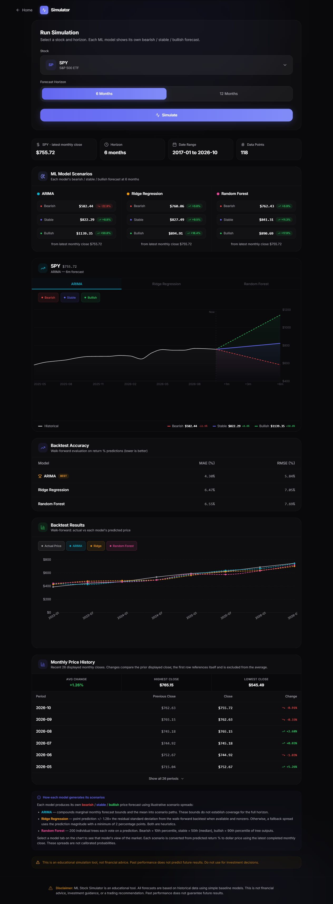
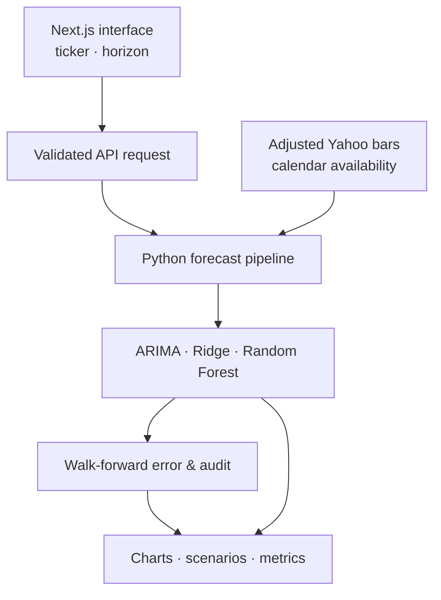

<div align="center">

# 📊 ML Stock Simulator

**Educational forecasts with explicit temporal evaluation.**

[](https://nextjs.org/)
[](https://react.dev/)
[](https://www.typescriptlang.org/)
[](pipeline/)
[](experiments/leakage_audit/README.md)
[](#-what-this-project-is-not)

**[Open live project](https://ml-stock-simulator.up.railway.app/simulator)**

<details>
<summary><strong>View the completed simulator screenshot</strong></summary>



</details>

<sub>Completed SPY six-month example on the live deployment. Displayed scenarios are illustrative, not calibrated probabilities.</sub>

</div>

---

## 📋 Contents

- [Overview](#-overview)
- [Key Capabilities](#-key-capabilities)
- [What the Audit Revealed](#-what-the-audit-revealed)
- [Separate Volatility Study](#-separate-volatility-study)
- [Architecture](#-architecture)
- [Tech Stack](#-tech-stack)
- [Getting Started](#-getting-started)
- [Repository Layout](#-repository-layout)
- [Evaluation Contracts](#-evaluation-contracts)
- [Limits & Next Steps](#-limits--next-steps)

---

## 💡 Overview

ML Stock Simulator began as a way to compare financial forecasting models through an approachable web interface: choose a stock, select a horizon, and examine the predictions alongside historical error.

The more valuable engineering work came later. A temporal audit uncovered that the original walk-forward backtest trained on targets whose **future price endpoints had not yet occurred**. The project now preserves the original contaminated baseline, the failing test, the correction, and side-by-side metrics.

| Typical forecasting demo | What this project tests |
|---|---|
| ❌ A future-looking training set hidden behind a backtest score | ✅ **Matured-label filtering** based on actual calendar periods and conservative information availability |
| ❌ A single model's bullish forecast | ✅ **ARIMA, Ridge, and Random Forest** on the same horizon and available data |
| ❌ A chart that silently fills gaps | ✅ Explicit handling of **missing months, partial bars, and unavailable target endpoints** |
| ❌ A polished number without its provenance | ✅ **Frozen experiment manifests, source hashes, raw predictions, and before/after audit reports** |
| ❌ A price forecast presented as a trading result | ✅ Educational forecasts, with **no trade execution or profitability claim** |

---

## ✨ Key Capabilities

| Feature | Description |
|---|---|
| 🎯 **Stock & horizon selection** | Explore ten allowlisted tickers, including `AAPL`, `MSFT`, `NVDA`, and `SPY`, at **6- or 12-month** horizons. |
| 🧠 **Three model families** | Compare ARIMA time-series forecasts with supervised Ridge regression and Random Forest. |
| 📊 **Interactive scenario views** | Inspect historical prices, model comparisons, and bearish / stable / bullish illustrations in a Next.js dashboard. |
| 🕰️ **Walk-forward evaluation** | Fit only on information available at each decision cutoff; report MAE/RMSE on held-out forecast dates. |
| 🔍 **Temporal audit trail** | Preserve original failing tests, corrected forecasts, training counts, skips, and source hashes. |
| 🧪 **Independent variance experiment** | Benchmark eight five-session variance forecasters against statistical baselines, separately from return prediction. |

### 🚫 What this project is not

- Not a brokerage-connected application, trading agent, or portfolio optimizer.
- Not a source of calibrated price probabilities; the displayed scenario bands are **heuristic illustrations**, not validated confidence intervals.
- Not evidence that any model will outperform the market.
- Not a point-in-time historical market-data archive: Yahoo's adjusted series can be revised retrospectively.

---

## 🔬 What the Audit Revealed

> [!IMPORTANT]
> **The original backtest was contaminated by look-ahead leakage.** A forecast made at month `t` must not train on a 6- or 12-month target whose endpoint lies after `t`. The corrected pipeline filters by **label availability**, not simply by whether a row appears earlier in an array.

### Representative before/after results

The table below uses **common forecast dates**, unrounded percentage-return predictions, and an isolated temporal-only correction. Original results are shown to document the bug, **not as valid out-of-sample estimates**.

| Ticker | Horizon | Common folds | Model | Original MAE → corrected MAE |
|---|---:|---:|---|---:|
| SPY | 6 months | 8 | Ridge | 5.23 → **6.48** |
| SPY | 6 months | 8 | Random Forest | 5.09 → **6.43** |
| SPY | 12 months | 6 | Ridge | 12.78 → **14.39** |
| AAPL | 12 months | 6 | Random Forest | 20.28 → **23.22** |

The corrected metrics were generally worse for these supervised models. That's the point: a credible evaluation can look **less impressive** after removing future information.

The audit also fixed an independent ARIMA issue: ndarray-shaped forecast outputs previously triggered a silent historical-mean fallback. The repaired implementation handles array and pandas outputs, records optimizer convergence separately from fit success, and reports fallback explicitly.

**Read the evidence:** [Temporal leakage audit, full comparison, failing-test capture, and replay instructions](experiments/leakage_audit/README.md).

<sub>These are small, correlated backtest samples; there is no statistical-significance claim. ARIMA-specific repairs changed more than label maturity, so its before/after movement is not attributed solely to leakage.</sub>

---

## 📉 Separate Volatility Study

The repository also includes a more targeted experiment: **forecast the average squared close-to-close log return over the next five exchange sessions**.

This is a variance proxy, **not** a five-day return forecast or a trading strategy.

- **Assets:** SPY and AAPL.
- **Evaluation:** 345 common five-session forecast folds per ticker, using fixed models and chronology.
- **Statistical baselines:** Five-session persistence, rolling 21, EWMA, and GARCH(1,1).
- **Additional models:** HAR-style OLS, Ridge, Random Forest, and extended Ridge.

| Model | SPY variance MAE | AAPL variance MAE |
|---|---:|---:|
| EWMA | 0.00012811 | 0.00029482 |
| **GARCH(1,1)** | **0.00012111** | **0.00028097** |
| Ridge | 0.00014879 | 0.00029923 |
| Random Forest | 0.00013384 | 0.00034365 |

In this particular historical snapshot, **GARCH had lower MAE than the supervised ML models for both assets**. Extended Ridge also generated invalid negative variance predictions for SPY, which the study preserved rather than quietly discarding.

**Details:** [Volatility research](experiments/volatility/README.md) · [Predeclared contract](experiments/volatility/CONTRACT.md)

---

## 🏗️ Architecture



The web interface displays model outputs; the Python pipeline owns data preparation, forecast generation, and temporal integrity. The independent volatility study lives under `experiments/volatility/` and does **not** share the return-forecast target.

---

## 🧱 Tech Stack

| Layer | Technology |
|---|---|
| Frontend | **Next.js 16**, React 19, TypeScript, Tailwind CSS 4 |
| Visualizations | Recharts, Framer Motion, Lucide |
| Forecasting | Python, pandas, NumPy, statsmodels, scikit-learn |
| Historical data | yfinance / Yahoo adjusted market bars |
| Additional volatility research | GARCH via `arch`, `exchange_calendars` |
| Verification | Offline pytest, ESLint, TypeScript, production build |

---

## 🚀 Getting Started

**Prerequisites:** Node.js **20.9+**, npm, Python **3.10+**, and pip.

```bash
git clone https://github.com/ZenzerJs/ML-Stock-Simulator.git
cd ML-Stock-Simulator

python -m venv .venv

# Windows PowerShell:
# .venv\Scripts\Activate.ps1
# macOS/Linux:
# source .venv/bin/activate

python -m pip install -r pipeline/requirements.txt pytest
npm ci
npm run dev
```

Open [http://localhost:3000/simulator](http://localhost:3000/simulator).

To call the Python entry point directly:

```bash
python pipeline/simulate.py SPY 6
python pipeline/simulate.py AAPL 12
```

The endpoint `POST /api/simulate` accepts an allowlisted `ticker` and `horizonMonths` of `6` or `12`. It runs the Python pipeline server-side and returns JSON for the UI.

### Verification commands

```bash
python -m pytest tests -q -p no:cacheprovider
npm run lint
npm run typecheck
npm run build
```

Historical Yahoo acquisition requires network access; the test suite does not. Python pipeline dependencies are not fully locked, so use the archived experiment manifests and retained snapshots for strict reproduction. The frontend uses `package-lock.json`.

---

## 📁 Repository Layout

```text
ML-Stock-Simulator/
├── src/app/                  # Next.js UI and /api/simulate
├── src/components/           # Charts, controls, scenario and metric views
├── pipeline/
│   ├── simulate.py           # Forecast pipeline
│   └── temporal.py           # Availability and calendar integrity
├── experiments/
│   ├── leakage_audit/        # Original bug, correction, metrics, evidence
│   └── volatility/           # Separate five-session variance research
├── tests/                    # Offline Python regression tests
└── package-lock.json         # Locked JavaScript dependencies
```

---

## 🔒 Evaluation Contracts

1. **Calendar-aligned horizons.** A six-month forecast means the close six **calendar months** ahead, not the sixth available row after gaps.
2. **Conservative information cutoffs.** A monthly bar is available no earlier than the start of the following month in New York time; partial months are excluded.
3. **Mature labels only.** Supervised targets must have reached their endpoints before training; missing periods are never bridged by filling or shifting rows together.
4. **Explicit ARIMA status.** Fit order, convergence, fallback, and unavailable return histories are recorded.
5. **Auditable outputs.** Source hashes, configuration, raw predictions, metric calculations, forecast dates, and exclusions are retained where captured.

---

## 🎓 Limits & Next Steps

The project began as an educational simulator and became a more rigorous study of **how financial models should be evaluated**. Historical Yahoo adjustments are not vintage data; forecast errors overlap in time; model selection and scenario bands do not establish investment utility.

Its next research question became a separate project:

> **Does better volatility prediction actually improve portfolio decisions after costs—and where do those decisions fail?**

That work continues in [**Ripple**](https://github.com/ZenzerJs/Ripple), which adds four-ETF portfolio replay, a fixed allocation policy, constrained stress testing, and a forward-decision ledger.

*Educational research only. No investment advice or automated trading.*

<div align="center">

*Built by [@ZenzerJs](https://github.com/ZenzerJs)*

</div>
